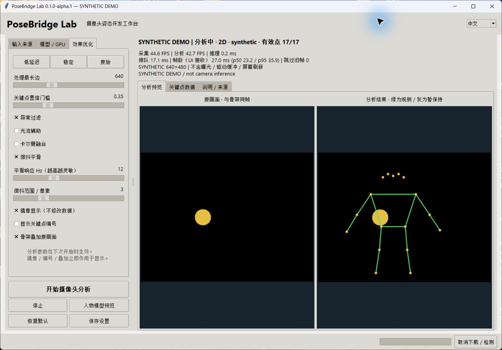
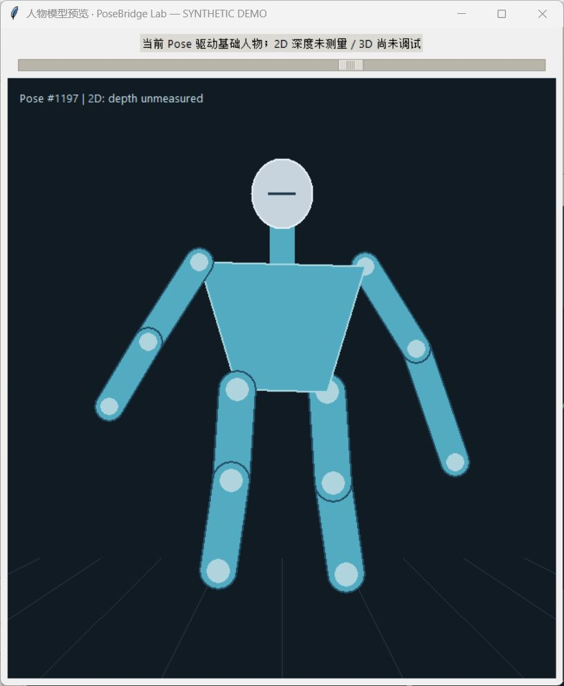
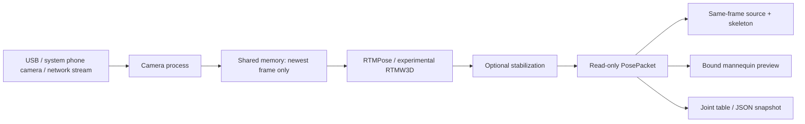

# PoseBridge Lab

**A Windows camera-pose workbench, built as an open-source foundation for future games.**

用摄像头观察动作，用同帧骨架、基础人物模型和时间统计理解识别结果。
当前版本 **0.1.0-alpha.1**。项目目前只做摄像头视觉分析；不是已完成的游戏插件。

## Start / 启动

Windows + Python 3.10 或更新版本（包含 Tk）。首次双击 **[Setup.cmd](Setup.cmd)** 安装本项目依赖，再双击 **[Start.cmd](Start.cmd)**。
已有本机开发环境时直接运行 Start.cmd。详细步骤见 **[Start.md](Start.md)**。

1. 点“检测输入来源”，选 USB、内置或系统已连接的手机／虚拟摄像头。
2. 在“模型 / GPU”下载 RTM Pose 2D 模型，或选择已有的对应 ONNX 文件。
3. 点“开始摄像头分析”，查看原画面、骨架和关键点数据。
4. 点“人物模型预览”，查看由同一份 Pose 数据绑定的基础人物模型。
5. 可选择 CUDA / DirectML，再点“一键配置 GPU”。安装和验证在本软件私有目录完成；成功后重启。

`Start.cmd --demo` 展示**合成动作演示**，不打开摄像头、不调用模型、不保存个人设置。它用于检查界面和人物绑定，不能作为真实跟踪效果或性能的证据。

下面两张图仅展示**合成演示**的界面与基础人物绑定，不是摄像头识别结果：

基础人物预览 / Synthetic mannequin preview

## What works / 当前功能

| 能力 | 状态与边界 |
| --- | --- |
| RTM Pose 2D | 复用原 OSR 项目相同的 RTMPose-s Body7 模型；保留 rtmlib 的预处理和解码。单人全画面输入。 |
| 摄像头来源 | DirectShow / MSMF 系统枚举；手动编号；申请分辨率、帧率和 MJPG / YUY2。支持系统提供的虚拟摄像头。 |
| 手机／无线画面 | 系统手机摄像头入口，或显式输入 RTSP / HTTP(S) 视频流地址。蓝牙配对不等于通用视频接口。 |
| 低延迟处理 | 独立采集进程、共享内存单帧槽、跳过旧帧、推理与 UI 分离、可调 CPU 线程。 |
| 观察与调试 | 同帧原画面／骨架、关键点置信度、观测／暂保持／缺失、采集／分析 FPS、推理／排队／帧龄。 |
| 效果调节 | 异常过滤、光流、卡尔曼、微抖平滑；置信门槛、处理尺寸、平滑响应、微抖范围滑块；低延迟／稳定／原始预设。 |
| 人物预览 | 姿态绑定的基础实体人形。2D 只驱动平面关节，体积用于显示；没有测得深度。 |
| RTM Pose 3D / RTMW3D | **实验、尚未调试**。单独的模型下载／选择和输出适配，不能称为已验证三维动捕。 |
| GPU | CUDA / DirectML 私有运行库安装、下载进度、真实执行检测、失败回退 CPU；不修改别的项目环境。 |
| 数据接口 | UI 无关的 `PosePacket` 与 `posebridge.pose.v1` JSON 快照；无摄像头图像。后续游戏可在此基础上接入。 |

模型是**单人 top-down Pose**，尚未接入人物检测器或多人身份跟踪。请让一个人的全身尽量在画面内。快速遮挡、多人重叠、出画、强模糊仍可能失效。

## Latency means what? / 延迟口径

软件记录的是图像从 `VideoCapture.read()` 返回后，到推理完成／界面取用之间的时间。
**它不包含摄像头曝光、硬件／驱动缓冲、无线编码传输或显示器刷新，不能标成端到端动作延迟。**
设置 60 FPS 不保证摄像头实际输出 60 FPS；某些 Windows 后端会拒绝缓冲区设置。界面显示实际采集和分析帧率。

2026-09-15 的一次本机 CPU 检查：640×480，实测约 30 FPS；151 次结果更新，推理中位数 16.07 ms，收到帧到结果消费者中位数 25.40 ms。该画面最后一帧没有可靠人体点，只验证摄像头、模型执行与停止链路；不是人体动作准确率测试，也不是通用性能承诺。完整记录和限制见 [Validation](docs/VALIDATION.md)。

## Architecture / 架构

各部分职责、坐标和未来游戏接口见 [ARCHITECTURE.md](docs/ARCHITECTURE.md)、[POSE_PROTOCOL.md](docs/POSE_PROTOCOL.md)。

## Reuse and contribution / 复用与贡献

本项目新增了摄像头进程与最新帧共享、调试工作台、姿态数据契约、人物绑定预览、输入来源管理、模型下载流程和相关回归测试。稳定处理和 GPU 安装／检测以 [LexZeon/osr-screen-tcode](https://github.com/LexZeon/osr-screen-tcode) 的 test.22 本地源码为基础移植；文件内保留来源并说明修改。

使用 [rtmlib](https://github.com/Tau-J/rtmlib)、[MMPose](https://github.com/open-mmlab/mmpose)、[OpenCV](https://github.com/opencv/opencv)、[ONNX Runtime](https://github.com/microsoft/onnxruntime) 和 [cv2_enumerate_cameras](https://github.com/lukehugh/cv2_enumerate_cameras)。最新帧采集的设计参考了 [imutils WebcamVideoStream](https://github.com/PyImageSearch/imutils/blob/master/imutils/video/webcamvideostream.py)，未复制该实现。

许可证、代码使用／设计参考的区别见 [THIRD_PARTY_NOTICES.md](THIRD_PARTY_NOTICES.md) 和 [NOTICE](NOTICE)。源码使用 Apache-2.0；不附带模型、可下载 GPU 运行库、用户视频或个人设置。

欢迎提交可复现的摄像头、遮挡恢复或延迟问题。见 [CONTRIBUTING.md](CONTRIBUTING.md)。项目的当前贡献是可运行、可观察、可测试的工具链，不宣称重新训练了 RTMPose 或解决了通用三维动捕。

## Next / 后续

- [ ] 用获得许可的真实动作片段建立可重复的质量／延迟基准。
- [ ] 增加可选的人物检测与稳定 ROI，比较检测频率对延迟的影响。
- [ ] 调试 RTMW3D 的坐标、比例和旋转；增加骨长约束及标定。
- [ ] 基于 `PosePacket` 制作明确的游戏引擎适配器，再验证坐标转换、角色重定向与 IK。

接手与开发规则见 [AGENTS.md](AGENTS.md) 和 [AI_HANDOFF.md](docs/AI_HANDOFF.md)。本机路径保存在未跟踪的本地接手文件中。

## English quick guide

Run Setup.cmd once, then Start.cmd. Detect a system camera, download the 2D model in the app and start analysis. Open Avatar preview for the pose-driven mannequin. Tune filters in the left panel; analysis changes apply on the next start. Mirror/overlay/IDs only change presentation. Restore Defaults returns to the low-latency preset, keeping downloaded model files.

Phone cameras must be exposed as a Windows camera or supply an RTSP/HTTP(S) stream. URLs are session-only. No Bluetooth sensor protocol is implemented. No camera images are automatically recorded, uploaded or included in JSON snapshots. Model/runtime downloads contact their documented upstream hosts only when requested.

The goal is a transparent open-source development project and a foundation for future games. 3D, game integration, retargeting and physical depth are explicitly not validated. See the validation report for tested behavior rather than treating the demo as a benchmark.
